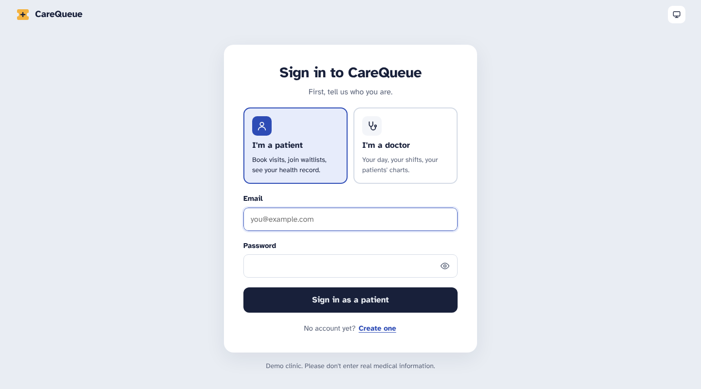
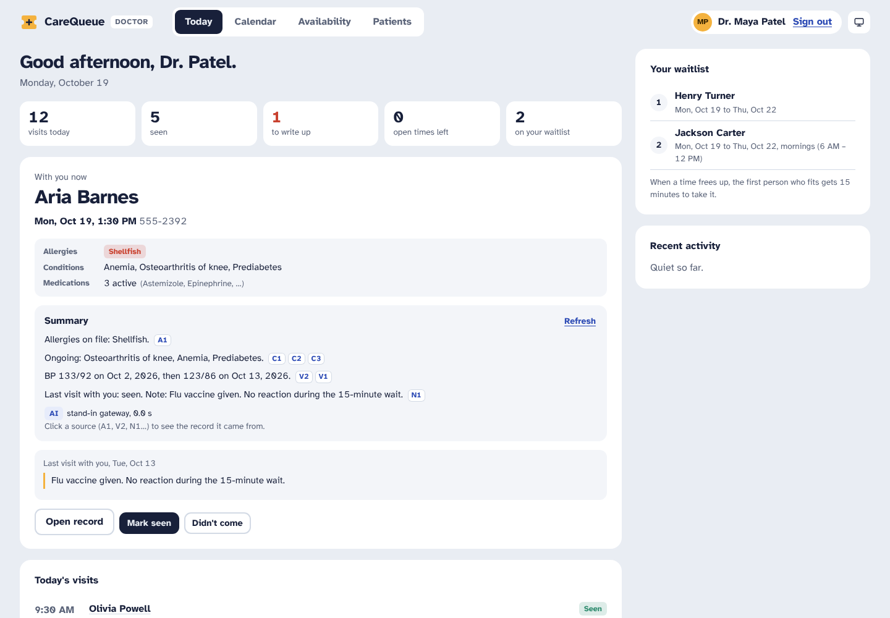
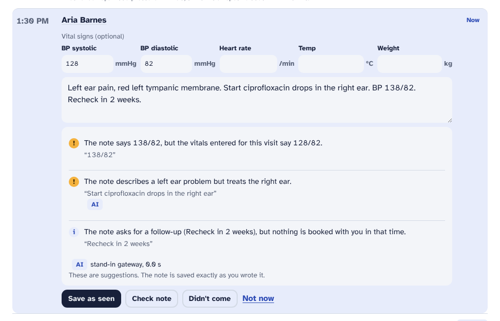
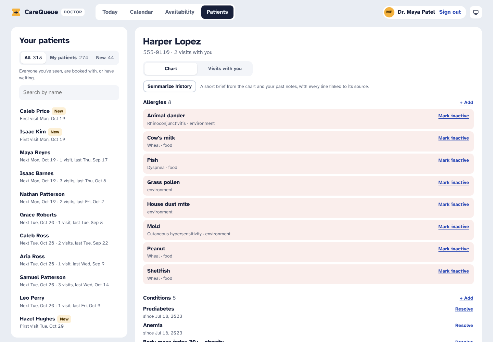
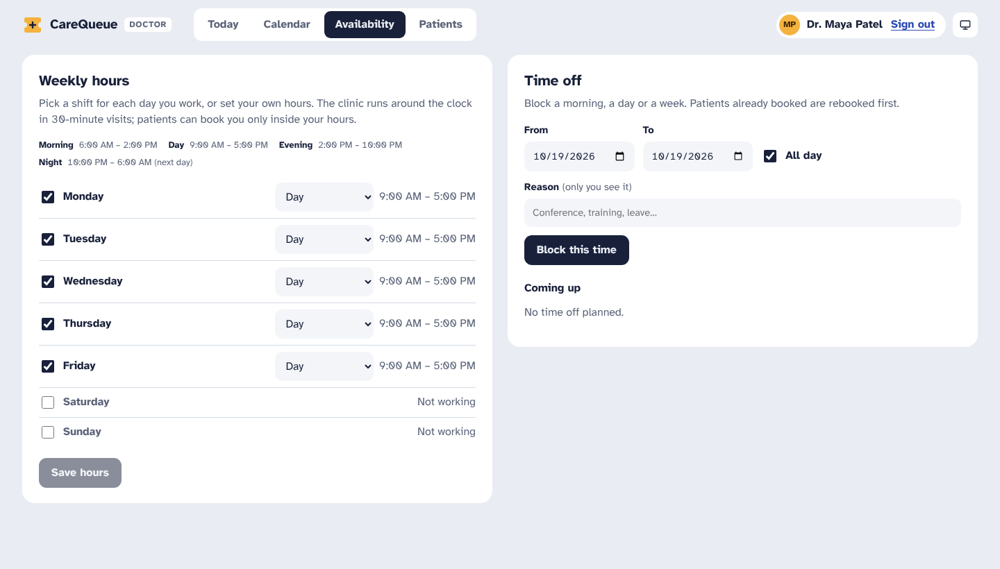
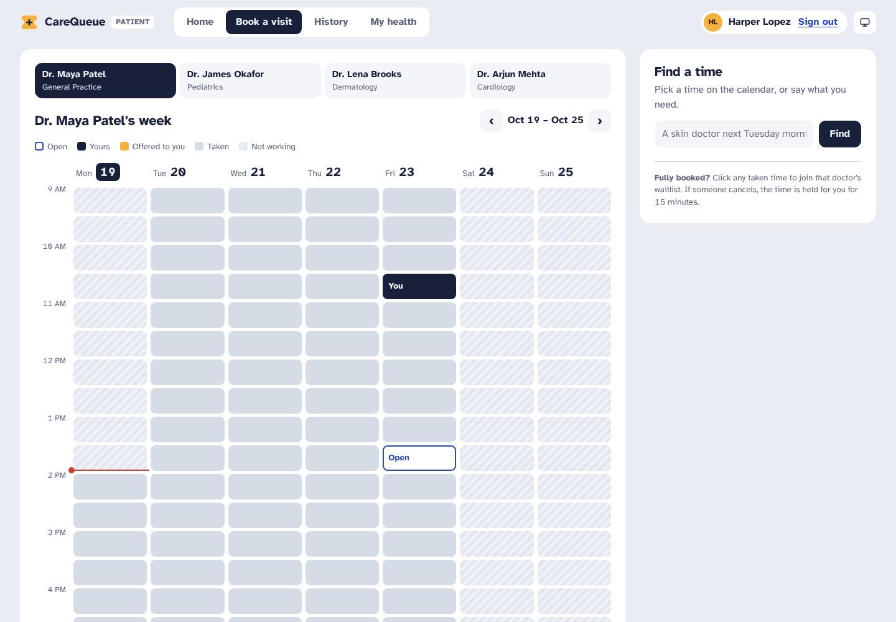
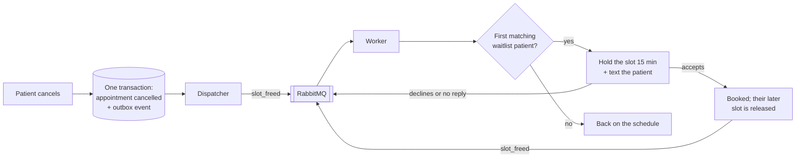

# CareQueue


**Live demo: [carequeue-0u3y.onrender.com](https://carequeue-0u3y.onrender.com)** · sign in as `maya.patel@demo.carequeue` or `harper.lopez@demo.carequeue`, password `carequeuedemo123`. It runs on Render's free tier, so the first visit can take about a minute while it wakes up.

CareQueue is a clinic scheduling app built around one problem: when a patient cancels, that slot usually goes to waste, while other patients are waiting days for an appointment. CareQueue fills those gaps automatically. Around that core it has a patient chart (with a FHIR R4 API) and two AI tools for doctors that check their own work before anyone sees it.



It has two portals behind a real sign-in:
- **Patients** see their next visit, book, reschedule or cancel, answer offers for earlier times, read their visit history with the doctor's notes, and see their own chart, including who has opened it.
- **Doctors** see who's next and their day at a glance, write up visits (vitals and notes), keep each patient's chart (allergies, conditions, medications, vitals), and pick their own shifts and time off.

Under that:
- **Patients book open slots**, and the database guarantees two people can never get the same one, even if they click at the same instant.
- **Patients who want something sooner join a waitlist**, for a specific doctor or any doctor in a specialty, with a date range and a part of the day (mornings, afternoons, evenings or nights).
- **When someone cancels, the slot is held for the first matching person on the waitlist** for 15 minutes. If they accept, it's theirs, and their old, later appointment is released to the next person in line. If they decline or don't answer, the slot moves on.
- **Doctors work in shifts, around the clock.** Each day can be a morning, day, evening or night shift (8 hours each; night runs past midnight) or custom hours. When a change closes time that already has patients in it, those patients are told and go to the front of the waitlist.
- **Patients can ask in plain words**, like "a skin doctor next Tuesday morning". The request goes through my [NexusAI](https://github.com/santhoshkumaar160302-ship-it/nexusai) LLM gateway, which turns it into a search over real availability.
- **Doctors get two AI checks through NexusAI:** a **note check** that flags mistakes in a visit note before it's saved, and a **history summary** before a visit. Every AI line is checked against the record in code, and both are measured on labeled tests (below).

**Built with:** Python, FastAPI, SQLAlchemy, PostgreSQL, Redis, RabbitMQ, React and TypeScript (Vite), Docker and GitHub Actions.

## Try it

Sign in with one of the sample accounts. Pick **I'm a doctor** or **I'm a patient** on the sign-in page first.

| Account | Email | Password |
| --- | --- | --- |
| Dr. Maya Patel, General Practice | `maya.patel@demo.carequeue` | `carequeuedemo123` |
| Harper Lopez, Dr. Patel's patient | `harper.lopez@demo.carequeue` | `carequeuedemo123` |

The other doctors are `james.okafor@`, `lena.brooks@` and `arjun.mehta@demo.carequeue`, and there are 24 sample patients (`firstname.lastname@demo.carequeue`). You can also create your own patient account. Doctor accounts are created by the clinic's management, never through the website.

Everyone in the demo is made up, and the charts come from [Synthea](https://synthetichealth.github.io/synthea/), a generator of realistic synthetic patients. Please don't enter real medical information.

The demo clinic is in Los Angeles: all times are Pacific Time (PT), wherever you're viewing from.

| Doctor's day, with the next patient's chart and AI summary | The note check on a visit write-up |
| --- | --- |
|  |  |
| **A patient's chart, kept by their doctors** | **Shifts: morning, day, evening, night or custom** |
|  |  |
| **Booking on a week calendar, with a plain-words search** | |
|  | |

The screenshots were taken against a stand-in gateway so they can be reproduced exactly; the live site uses NexusAI.

## How a cancellation gets refilled



1. **Cancelling and recording the event happen together.** The cancellation and a `slot_freed` event are written in the same database transaction (the transactional outbox pattern). If the app crashes a moment later, the event isn't lost: it's still in the outbox and gets sent on the next pass.
2. **A dispatcher publishes the event to RabbitMQ.** A separate worker picks it up, so a slow step never holds up the patient's request.
3. **The worker finds the first person in line who fits:** right doctor or specialty, date in their range, right part of the day, not already busy at that time, and, if they're trying to move up, earlier than what they have now.
4. **The slot is held for them, not booked.** They get a text and 15 minutes to accept. Nobody is booked without saying yes.
5. **Accepting can set off a chain.** Their old, later appointment frees up and goes through the same steps, so one cancellation can move several people up.

## AI tools for doctors, and how they're kept honest

Both tools go through NexusAI, which picks the model, fails over between providers and reports the cost. CareQueue treats every answer as untrusted.

**Note check.** When a doctor writes up a visit, **Check note** looks for mistakes before the note is saved. It works in two layers:
- **Rules in code** catch impossible values (BP 1380/88), readings that disagree with the vitals entered for the visit, a drug the patient is allergic to (penicillin allergy, amoxicillin prescribed), and follow-ups the note asks for that aren't booked. They're instant and always on.
- **The AI** looks for what rules can't: the note contradicting itself (left ear, right ear drops), the note contradicting the chart ("continue glipizide" when it was stopped), and a diagnosis with no plan.

The AI's findings are checked in code before the doctor sees them:
- a finding must quote the doctor's exact words, or it's dropped;
- "no plan" is dropped if the note has a plan word (start, continue, a dose, review, rest);
- "doesn't match the chart" is dropped when the chart has nothing to conflict with.

The findings are suggestions only. The note is saved exactly as the doctor wrote it.

**History summary.** Before a visit, **Summarize history** writes a short brief from the patient's chart and this doctor's own past notes (other doctors' notes stay private). Every fact gets an id (A1 = an allergy, V2 = a set of vitals, N1 = a visit note), and the model must cite the ids each line is based on. Then every line is checked:
- it must cite at least one real id;
- every number and unit in it (138/88, 75.5 kg, Oct 16, 2026) must appear in the facts it cites.

Lines that fail are dropped, so a made-up reading can't reach the doctor. Open items, like an overdue follow-up or a high last BP, are found by plain code. If NexusAI is unavailable, a basic summary built straight from the record is shown, so the button always works.

Every chart view, chart change, note check and summary is written to an access log, which the patient can see.

## What's inside

| Part | What it does | Where |
| --- | --- | --- |
| Booking | Books, cancels and shows each doctor's day. A partial unique index (`one active appointment per slot`) makes double-booking impossible at the database level. | `carequeue/clinic.py`, `models.py` |
| Waitlist | Matching (doctor or specialty, dates, part of the day), 15-minute holds, accept / decline / expiry, and moving patients up into earlier slots. | `carequeue/clinic.py` |
| Events | Transactional outbox, plus a dispatcher and consumer on RabbitMQ (or an in-process queue without `RABBITMQ_URL`). Consumers are idempotent, so a message delivered twice does no harm. | `carequeue/broker.py`, `clinic.py`, `worker.py` |
| Cache | Each doctor's day is cached in Redis and cleared whenever a booking, cancellation, hold or expiry touches that day. If Redis is down, reads go straight to the database. | `carequeue/cache.py` |
| Shifts and time off | A 24/7 slot grid; each doctor's shifts (four 8-hour presets or custom hours, overnight included) and time off decide what's bookable. Closing time that has patients in it rebooks them first; opening time offers it to the waitlist. Doctors see who'd be affected before they confirm. | `carequeue/availability.py` |
| Chart | Allergies, conditions, medications and vitals, with SNOMED, RxNorm, LOINC and UCUM codes. A doctor can only open the chart of a patient they've seen, are booked with or have waiting; a warning appears when a new medication matches an allergy. Every view and change is logged. | `carequeue/chart.py` |
| FHIR R4 API | `Patient`, `AllergyIntolerance`, `Condition`, `MedicationStatement`, `Observation` (vitals, including the blood-pressure panel) and `Encounter`, plus `Patient/$everything` and a `CapabilityStatement`. Validated in tests by parsing every resource with the `fhir.resources` R4B models (R4B is the R4-compatible update). | `carequeue/fhir.py` |
| Note check | Rules, then the AI, then code checks on the AI's findings (above). | `carequeue/notecheck.py` |
| History summary | Numbered facts, cited lines, and a check on every number (above). | `carequeue/summary.py` |
| Gateway client | Asks NexusAI for JSON with a time limit, and treats any failure as "AI unavailable" so every feature has a fallback. | `carequeue/llm.py` |
| Assistant | Plain-words search. The LLM only extracts what the patient wants as JSON, which is validated: unknown doctors and impossible dates are rejected. If the gateway is slow or unreachable, keyword rules answer. | `carequeue/assistant.py` |
| Sign-in | Patients sign up themselves (with date of birth and sex for their chart); doctor accounts are created by management. Passwords hashed with scrypt, sessions in an HttpOnly cookie (only a hash of the token is stored), 5 failed sign-ins per 5 minutes, and roles checked on every request. | `carequeue/auth.py` |
| Visits | A doctor's day, next patient and their last visit, visits still to write up (including earlier days'), patient records; a patient's home page and history. Every query is scoped to the signed-in person. | `carequeue/visits.py` |
| API | FastAPI, with clear error messages (401 when signed out, 403 for the wrong role, 404 for records that aren't yours, 409 for conflicts). | `carequeue/app.py` |
| UI | React + TypeScript. **Patients:** home (next visit, offers with a live 15-minute countdown, waitlist, messages), booking on a week calendar with plain-words search, history, and My health. **Doctors:** today, a week calendar with each slot's story, shifts and time off, and patients with their charts. Light and dark themes, and it works on a phone. | `frontend/` |
| Simulation | Runs the real scheduling code through months of simulated clinic traffic, with and without the waitlist. | `scripts/simulate.py` |

## Getting started

### Run it locally (no databases needed)

```bash
pip install -r requirements-dev.txt
cd frontend && npm install && npm run build && cd ..
echo 'CQ_DEMO_PASSWORD=choose-a-password' >> .env
uvicorn carequeue.app:create_app --factory --reload
```

Open http://localhost:8000 and sign in to a sample account with the password you chose. The app creates a demo clinic in a local SQLite file:
- four doctors on day shifts (one also works Saturday mornings);
- made-up patients, 80 of them with Synthea charts;
- eight weeks of past visits with notes, two weeks of bookings ahead, and a short waitlist.

Without Redis or RabbitMQ it uses an in-memory cache and queue, so every feature works.

**Try it from both sides:**
1. Sign in as Dr. Patel. Open **Availability**, switch Monday to the **Night** shift, and click **Save hours**. Before anything changes, it lists the patients booked in the daytime hours you're closing.
2. Confirm. On the **Calendar**, those patients' new offers appear in yellow within a second or two.
3. On **Today**, open the next patient's **Summarize history**, then write up a visit and click **Check note**.
4. Sign in as Harper Lopez. Cancel a visit on **Home**, and see **My health** and who opened your chart.

For UI development with hot reload, run `npm run dev` in `frontend/` (it proxies `/api` to port 8000).

### Run the full stack with Docker

```bash
docker compose up --build
```

This starts the API, a separate background worker, PostgreSQL, Redis and RabbitMQ. The RabbitMQ dashboard is at http://localhost:15672 (guest / guest).

### The AI features (NexusAI)

Set `NEXUSAI_URL` (and `NEXUSAI_API_KEY` if your gateway uses one), for example in `.env`:

```
NEXUSAI_URL=https://nexusai-latest.onrender.com
```

Without it, everything still works:
- the search uses keyword rules ("skin" means Dermatology, "next Tuesday", "mornings", and so on);
- the note check uses its rules only;
- the summary is the basic one built from the record.

The UI always shows which one answered. A search waits at most 3 seconds for the LLM (`NEXUSAI_TIMEOUT_S`); the doctor tools wait up to 15 seconds (`NEXUSAI_DOCTOR_TIMEOUT_S`), because a doctor clicks a button and expects to wait a moment.

## Results: does the waitlist actually help?

`python scripts/simulate.py` runs the real `Clinic` code through 12 weeks of a simulated clinic, once without and once with the waitlist. Both runs use the same patients, requests and cancellations.

The setup models a busy specialty clinic:
- four doctors, each with 16 half-hour slots a day;
- demand at 120% of capacity;
- 15% of appointments cancelled, half of them in the last 48 hours;
- most patients booking 2–10 days ahead;
- 60% of patients agreeing to join the waitlist;
- offers accepted 70% of the time, declined 15%, and ignored 15%.

Three runs with different random seeds (`--seed`):

| | Slots used, without → with waitlist | Gain | Average time from request to visit | Events |
| --- | --- | --- | --- | --- |
| Default seed | 95.7% → **99.6%** | +3.9 points | −7.8% | 12,361 |
| Seed 3 | 95.7% → **97.8%** | +2.1 points | −5.6% | 11,886 |
| Seed 11 | 95.4% → **97.5%** | +2.1 points | −5.0% | 11,847 |

So the waitlist raised slot use by **2–4 percentage points** and cut the average wait by **5–8%** across about 36,000 simulated events. In the default run, 1,789 offers were made and 1,285 accepted (72%), and the average delay past the day the patient wanted fell from 2.60 to 2.01 days.

The gain comes from **late cancellations**. A slot freed a day ahead is rarely taken by a new patient, because most people book further ahead. Someone who is already waiting will gladly take it. These numbers depend on the assumptions above: with fewer late cancellations, or more same-day demand, the gain shrinks. The script's flags (`--load`, `--cancel-rate`, `--same-day-share`, `--waitlist-rate`) let you test other clinics. Results are in `results/simulation.json`.

## Results: does the AI search help?

The "Find a time" box can understand requests in two ways: keyword rules, or an LLM through NexusAI. `python scripts/eval_assistant.py` measures both on 60 labeled requests (`evals/assistant_requests.jsonl`), each with the right doctor or specialty, dates and time of day. They range from easy ("Okafor tomorrow") to messy ("dermatolgy apointment nxt week", "my 6 year old needs a sports physical next Wednesday"). "Today" is fixed at Thursday, Oct 15, 2026, so the labels don't go stale.

| | Keyword rules | LLM via NexusAI | **What patients get** (LLM, rules after 3 s) |
| --- | --- | --- | --- |
| Fully correct (every field) | 35/60 (58%) | **58/60 (97%)** | **54/60 (90%)** |
| Doctor or specialty | 55/60 (92%) | 60/60 (100%) | 60/60 (100%) |
| First date | 50/60 (83%) | 59/60 (98%) | 58/60 (97%) |
| Last date | 42/60 (70%) | 58/60 (97%) | 54/60 (90%) |
| Time of day | 58/60 (97%) | 60/60 (100%) | 60/60 (100%) |
| Mean wait | under 1 ms | 1.9 s | 1.4 s |
| Slowest 5% (p95) | under 1 ms | 6.2 s | 3.0 s (the limit) |

Measured on Oct 18, 2026 against the live gateway, with NexusAI's cache bypassed so every answer came from a model. NexusAI's router chose the models: Gemini 3.1 Flash-Lite for 30 answers, Gemini 3.5 Flash-Lite for 29 and Gemini 3.6 Flash for 1. This was before evenings and nights were added to the search. There were no gateway errors, and the run cost about $0.015, roughly **$0.25 per 1,000 searches**. Results are in `results/assistant_eval.json`.

What this shows:
- **The rules get the doctor right but struggle with dates:** "Oct 22", "the 21st", "Tuesday or Wednesday", "in the next 3 days", "tmrw". The LLM handles nearly all of them, typos included.
- **The LLM is sometimes slow:** 11 of 60 answers took longer than 3 seconds. For those, the app uses the rules' answer, so patients never wait more than 3 seconds and still get 90% fully correct.
- **Speed came from one setting.** Gemini models "think" before answering by default. The first run averaged about 10 seconds per request, with single answers taking up to 25 seconds. Setting `GEMINI_REASONING_EFFORT=low` on the NexusAI service brought simple answers down to about 2 seconds, without losing accuracy.
- **The LLM's two misses are borderline:** "in the next 3 days" ended on Saturday instead of Sunday, and "Thursday afternoon", asked on a Thursday, became next Thursday.

Two safeguards sit between the model and the search:
- **A time limit.** A search waits at most 3 seconds for the LLM, then the rules answer. A slow model can make results less precise, never slow.
- **A check against the patient's own words.** If the model narrows the search to a doctor the patient never named ("my son has a fever" → Dr. Okafor), the search widens to that doctor's specialty, so other doctors' open times aren't hidden. Before this check, 3 of 60 answers made that mistake; after it, none did.

One caveat: the prompt spells out the clinic's conventions ("next Tuesday" means Tuesday of next week, children go to Pediatrics even for a rash). Those conventions match how the requests were labeled, so this measures how well each approach follows the clinic's rules. It isn't a general benchmark of language understanding.

## Results: does the note check find mistakes?

`python scripts/eval_notes.py` runs the note check on 68 short visit notes (`evals/note_checks.jsonl`), each with the patient's chart:
- **47 notes have one planted mistake each**, with the words that show it. For a contradiction, both sides count, since quoting either one points at the mistake.
- **21 notes are clean and realistic**, and should raise nothing. Some are tricky on purpose: "allergic to penicillin, so azithromycin", "take 1/2 tablet", "return if not better in a week".

| | Rules only | Rules + AI via NexusAI |
| --- | --- | --- |
| Mistakes caught | 22/47 (47%) | **45/47 (96%)** |
| Impossible values / vitals that disagree | 8/8 / 4/4 | 8/8 / 4/4 |
| Allergy conflicts / unbooked follow-ups | 6/6 / 4/4 | 6/6 / 4/4 |
| Contradictions | 0/11 | **11/11** |
| Chart mismatches | 0/6 | **6/6** |
| Missing plans | 0/8 | 6/8 |
| Clean notes flagged | 0/21 | **0/21** |
| False alarms (all notes) | 0 | 1 |
| Time per note | instant | 2.0 s mean, 4.0 s p95 |

Measured on Oct 18, 2026 against the live gateway. The AI was unavailable on 1 of 68 notes (a timeout); the rules still ran on that one.

**How it got there.** The first live run caught 83% of mistakes but raised **15 false alarms** and flagged 4 of 15 clean notes, mostly "no plan" on notes that had one. The fixes were the code checks described above, a stricter prompt, and scoring that accepts either side of a contradiction. To check that the fixes weren't just fitted to those notes, 12 new cases were written afterwards (marked `"added": "round 2"`). On those, the AI caught 5 of 6 mistakes and flagged 0 of 6 clean notes.

**The two misses, and a known trade-off.**
- **Pneumonia with no plan** is a plain model miss.
- **Gastroenteritis with no plan**, in a note that says "continue lisinopril" for blood pressure, is hidden on purpose. The "no plan" check drops the flag when the note has any plan word, so a plan for one problem hides a missing plan for another. I chose fewer false alarms over that catch, because a check that cries wolf gets ignored. A test records the trade-off.

## Results: can the summary be trusted?

`python scripts/eval_summary.py` asks NexusAI for a summary of 30 real demo patients across all four doctors, and checks every line:

| | Result |
| --- | --- |
| Summaries written by the AI | 30/30 (none fell back to the basic summary) |
| Lines kept / per summary | 130 / 4.3 |
| Lines dropped by the source check | 1 |
| Allergy mentioned, when the patient has one | 8/8 |
| **Tamper test:** a copy of every kept line with one number changed (138/88 → 145/88) | **95/95 rejected** |
| Time per summary | 2.4 s mean |
| Cost | $0.028 for 30, about $0.93 per 1,000 summaries |

Measured on Oct 18, 2026 against the live gateway. The one dropped line was the check being too strict: the model wrote an upcoming visit's year, which the record didn't spell out. Upcoming visits now include the year.

The tamper test is the important one. It measures the guard itself rather than the model: a summary line with a reading or date that isn't in the record can't reach the doctor.

To run all three tests against your own gateway:

```bash
python scripts/eval_assistant.py --nexusai-url https://nexusai-latest.onrender.com --show-failures
python scripts/eval_notes.py --nexusai-url https://nexusai-latest.onrender.com --show-misses
python scripts/eval_summary.py --nexusai-url https://nexusai-latest.onrender.com --show-dropped
```

NexusAI's cache is bypassed during the tests, so every answer and every timing comes from a model. CI runs the parts that don't need a model on every push: the search rules must stay above 55%, the note rules must catch 95% of their mistake types with no clean note flagged, and the summary check must reject every tampered number.

## API

Everything except health, the list of doctors and sign-in needs a session cookie. Patient routes always act on the signed-in patient and doctor routes on the signed-in doctor; ids sent by the browser can't point them at someone else.

| Method and path | What it does |
| --- | --- |
| `POST /api/auth/login` `{email, password, role}`, `register`, `logout`; `GET /api/auth/me` | Sign in (a right password on the wrong role gets a hint, not a session), create a patient account, sign out, who am I |
| **Patient** | |
| `GET /api/me/overview` | Next visit, upcoming visits, offers, waitlist, last visit, messages |
| `GET /api/me/history` | Past visits with the doctor's notes, and cancellations |
| `GET /api/me/chart`, `GET /api/me/access-log` | Your chart, and who opened or changed it |
| `GET /api/me/week?provider_id=1&start=2026-10-19` | A doctor's week as a patient sees it: open, taken, yours, offered to you, unavailable. No other patients' names or ids. |
| `POST /api/me/appointments` `{slot_id}` | Book. Returns 409 if someone else got the slot first. |
| `POST /api/me/appointments/{id}/reschedule` `{slot_id}` | Move a visit. The new slot is booked before the old one is released. |
| `POST /api/me/appointments/{id}/cancel`, `accept`, `decline` | Cancel (the slot goes to the waitlist), or answer an offer |
| `POST /api/me/waitlist`, `DELETE /api/me/waitlist/{id}` | Join or leave the waitlist |
| `POST /api/me/assistant` `{text}` | Plain-words search; returns what it understood and matching open slots |
| **Doctor** | |
| `GET /api/doctor/today` | Today's visits, visits still to write up, the next patient with their last visit and chart brief, and counts |
| `GET /api/doctor/week?start=…`, `GET /api/doctor/slots/{id}` | The doctor's week with names, and one slot's story |
| `POST /api/doctor/appointments/{id}/complete` `{note, vitals}`, `no-show`, `cancel`; `PUT …/note`, `PUT …/vitals` | Close a visit, cancel one (the patient is rebooked first), edit a note or vitals |
| `POST /api/doctor/appointments/{id}/check-note` `{note, vitals}` | The note check |
| `POST /api/doctor/patients/{id}/summary` | The history summary, with each line's sources |
| `GET /api/doctor/patients/{id}/chart`, `…/access-log` | A patient's chart, and its access log |
| `POST /api/doctor/patients/{id}/allergies`, `conditions`, `medications`; `POST /api/doctor/allergies/{id}/status`, `conditions/{id}/resolve`, `medications/{id}/stop` | Keep the chart |
| `GET` / `PUT /api/doctor/hours`, `POST …/preview`, `GET /api/doctor/shifts` | Weekly shifts, who a change would affect, and the shift presets |
| `GET` / `POST /api/doctor/time-off`, `POST …/preview`, `DELETE …/{id}` | Time off, and who it would affect |
| `GET /api/doctor/patients?q=&group=`, `GET /api/doctor/patients/{id}` | Patients ("my patients" or new) and their visits with this doctor only |
| `GET /api/doctor/waitlist`, `activity`, `metrics` | The doctor's waitlist, recent events, clinic stats |
| **FHIR R4** (signed in, same access rules as the chart) | |
| `GET /fhir/metadata` | `CapabilityStatement` |
| `GET /fhir/Patient/{id}`, `GET /fhir/Patient/{id}/$everything` | A patient, or everything about them as a `Bundle` |
| `GET /fhir/{AllergyIntolerance,Condition,MedicationStatement,Observation,Encounter}?patient={id}` | Search one resource type |
| `GET /api/health`, `GET /api/providers` | Service status and the list of doctors (public) |

Interactive API docs are at `/docs`.

## Tests

```bash
pytest
```

There are 101 test functions. Every scheduling test runs on both SQLite and PostgreSQL, so there are 162 runs in all, and coverage is 94%. They cover:
- **booking:** double-booking under real concurrency (20 threads racing for one slot on PostgreSQL, exactly one wins), past slots, and patients double-booked at the same time;
- **the waitlist:** first in line, matching by doctor, specialty and part of the day (an 11 PM opening goes to the patient who asked for nights, not the one ahead of them who asked for mornings), holds, declines, expiry, moving up and the chain it sets off, and idempotent event handling;
- **events, the cache, Redis and RabbitMQ**, against real servers;
- **shifts and time off:** every preset, a night shift past midnight, custom hours to midnight, displaced patients going to the front of the line, withdrawn offers, reopened time, and a doctor's write-up pile at the weekend;
- **the chart and FHIR:** access rules, allergy warnings, the access log, and every resource parsed with the `fhir.resources` R4B models plus checks of the code values;
- **the note check and summary:** each rule, dropping AI findings that don't quote the note or that the note itself disproves, dropping summary lines with made-up numbers, falling back when the gateway fails, and the scoring of both tests;
- **sign-in and roles:** patient sign-up (including date of birth and sex reaching the chart), no doctor sign-up, the sample-account password setting, the wrong-role hint, the sign-in limit, and nobody touching another patient's records;
- **the assistant:** the keyword parser (including evenings, nights and "last night" being about the symptom, not the visit), validation of LLM output, and the accuracy test's scoring;
- **the HTTP API.**

To include PostgreSQL, Redis and RabbitMQ locally, set `CQ_TEST_DATABASE_URL`, `CQ_TEST_REDIS_URL` and `CQ_TEST_RABBITMQ_URL`. CI does this on every push.

## CI/CD

**CI** runs on every push:
- lints the code;
- runs the tests against real PostgreSQL, Redis and RabbitMQ, and fails below 90% coverage;
- runs a short simulation that fails if the waitlist stops beating the baseline;
- runs the search, note-check and summary tests that don't need a model;
- type-checks and builds the React app;
- builds the Docker image, starts it, signs in to the sample accounts and calls the API.

**CD** runs when CI passes on `main`. It publishes the image to GitHub Container Registry, deploys that exact image to Render, and waits until the live site reports the new commit. Setup steps are in [DEPLOYMENT.md](DEPLOYMENT.md).

## Decisions worth explaining

- **The database prevents double-booking, not the code.** Checking "is this slot free?" and then inserting leaves a gap where two requests can both see it as free. A partial unique index on `appointments(slot_id) WHERE status IN ('booked','held')` closes that gap: the second insert fails, and the API returns a friendly 409. The 20-thread test proves it on PostgreSQL.
- **Hold, don't book.** Booking a waitlisted patient automatically would fill the schedule with people who may not come. A 15-minute hold asks first, and an unanswered hold moves on to the next person.
- **The transactional outbox.** Writing the change and then publishing to RabbitMQ as two separate steps can lose events if the app crashes in between. Writing the event in the same transaction and publishing it afterwards means it gets sent at least once. Consumers check whether an event was already processed, so receiving it twice is harmless.
- **The AI suggests; code decides what reaches the doctor.** The search model only turns text into a structured search, which is validated. Note-check findings must quote the note. Summary lines must cite real facts and can't contain a number the record doesn't have. Each check is measured, not assumed.
- **Every AI feature has a fallback.** Keyword rules for search, the rule layer for the note check, a basic summary built from the record. A slow or missing gateway makes things less clever, never broken.
- **Hours change what's bookable, not what exists.** Slots exist around the clock on a fixed grid, and each is bookable or not depending on the doctor's shifts and time off. Changing hours never deletes history, and opening time back up sends it straight to the waitlist.
- **Parts of the day are fixed windows.** "Morning" means 6 AM to noon, not "before noon", so a night shift never offers a 1 AM visit to someone who asked for mornings. The four windows cover the clock exactly once.
- **Doctors can't sign up.** Patients create their own accounts; doctor accounts are created by the clinic's management, since a doctor account can read charts.
- **The server decides who you are.** Patient routes ignore any patient id from the browser and use the session's. A record that isn't yours returns 404, not 403, so ids can't be probed.
- **The sample accounts' password isn't in the code.** It comes from `CQ_DEMO_PASSWORD` and is applied on every start; without it, nobody can sign in to them.
- **Times are clinic-local, in one time zone.** A 9:00 AM visit means 9:00 AM at the clinic, so every viewer sees the clinic's time, as patient portals usually do, labelled with the zone (PT). The zone is set with `CQ_CLINIC_TIMEZONE` (Pacific for the demo), and the server's clock reads it too, so a server running on UTC still knows what "today" is; the FHIR API adds the offset. The limit: one deployment serves one time zone. Clinics in several zones, or telehealth across zones, would need times stored in UTC and converted for each clinic.

## Project layout

```
carequeue/
  app.py           FastAPI routes; serves the built React app
  auth.py          password hashing, sessions, roles, sample accounts
  availability.py  shifts, time off, rebooking displaced patients
  visits.py        doctor's day and patients, patient home and history
  clinic.py        booking, cancellation, waitlist matching, holds, events, metrics
  chart.py         allergies, conditions, medications, vitals, access log
  fhir.py          the FHIR R4 API
  llm.py           NexusAI client (JSON answers, time limits)
  notecheck.py     note check: rules, AI, and checks on the AI
  summary.py       history summary with cited, checked lines
  assistant.py     plain-words search via NexusAI, with a keyword fallback
  models.py        tables, including the no-double-booking index
  broker.py        RabbitMQ and in-memory queues
  cache.py         Redis and in-memory schedule cache
  worker.py        standalone background worker
  seed.py          demo clinic data
  data/            Synthea charts used by the demo
frontend/          React + TypeScript app (Vite)
scripts/           simulate.py, eval_assistant.py, eval_notes.py, eval_summary.py, import_synthea.py
evals/             labeled requests and visit notes for the tests above
results/           saved results of the simulation and tests
docs/screenshots/  the pictures in this README
tests/             pytest suite
```