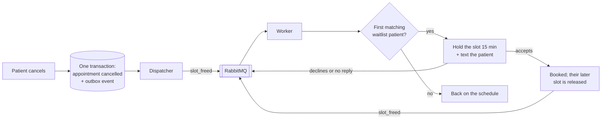

# CareQueue


CareQueue is a clinic scheduling app built around one problem: when a patient cancels, that slot usually goes to waste, while other patients are waiting days for an appointment. CareQueue fills those gaps automatically.

It has two portals behind a real sign-in:
- **Patients** see their next visit, book, reschedule or cancel, answer offers for earlier times, and read their visit history with the doctor's notes.
- **Doctors** see who's next and their day at a glance, mark visits as seen (with notes) or missed, look up their patients' history with them, and set their own weekly hours and time off.

Under that:
- **Patients book open slots**, and the database guarantees two people can never get the same one, even if they click at the same instant.
- **Patients who want something sooner join a waitlist**, either for a specific doctor or for any doctor in a specialty, with a date range and a time of day.
- **When someone cancels, the slot is held for the first matching person on the waitlist** for 15 minutes. If they accept, it's theirs, and their old, later appointment is released to the next person in line. If they decline or don't answer, the slot moves on to the next person.
- **When a doctor blocks time that already has patients in it**, those visits are cancelled, each patient is told, and they go to the front of that doctor's waitlist, so they're offered the next free time first.
- **Patients can ask in plain words**, like "a skin doctor next Tuesday morning". The request goes through my [NexusAI](https://github.com/santhoshkumaar160302-ship-it/nexusai) LLM gateway, which turns it into a search over real availability.

**Built with:** Python, FastAPI, SQLAlchemy, PostgreSQL, Redis, RabbitMQ, React and TypeScript (Vite), Docker and GitHub Actions.

## How a cancellation gets refilled



1. **Cancelling and recording the event happen together.** The cancellation and a `slot_freed` event are written in the same database transaction (the transactional outbox pattern). If the app crashes a moment later, the event isn't lost: it's still in the outbox and gets sent on the next pass.
2. **A dispatcher publishes the event to RabbitMQ.** A separate worker picks it up, so a slow step never holds up the patient's request.
3. **The worker finds the first person in line who fits:** right doctor or specialty, date in their range, right time of day, not already busy at that time, and, if they're trying to move up, earlier than what they have now.
4. **The slot is held for them, not booked.** They get a text and 15 minutes to accept. Nobody is booked without saying yes.
5. **Accepting can set off a chain.** Their old, later appointment frees up and goes through the same steps, so one cancellation can move several people up.

## What's inside

| Part | What it does | Where |
| --- | --- | --- |
| Booking | Books, cancels and shows each doctor's day. A partial unique index (`one active appointment per slot`) makes double-booking impossible at the database level. | `carequeue/clinic.py`, `models.py` |
| Waitlist | Matching, 15-minute holds, accept / decline / expiry, and moving patients up into earlier slots. | `carequeue/clinic.py` |
| Events | Transactional outbox, plus a dispatcher and consumer on RabbitMQ (or an in-process queue without `RABBITMQ_URL`). Consumers are idempotent, so a message delivered twice does no harm. | `carequeue/broker.py`, `clinic.py`, `worker.py` |
| Cache | Each doctor's day is cached in Redis and cleared whenever a booking, cancellation, hold or expiry touches that day. If Redis is down, reads go straight to the database. | `carequeue/cache.py` |
| Assistant | Natural-language search through NexusAI. The LLM only extracts what the patient wants as JSON, and that output is validated: unknown doctors and impossible dates are rejected. If the gateway is unreachable, keyword rules take over. | `carequeue/assistant.py` |
| Sign-in | Passwords hashed with scrypt, sessions in an HttpOnly cookie (only a hash of the token is stored), a limit of 5 failed sign-ins per 5 minutes, and patient / doctor roles checked on every request. | `carequeue/auth.py` |
| Availability | Weekly hours and time off. Slots outside them can't be booked. Blocking time that has patients in it cancels those visits and rebooks the patients first; opening time offers it to the waitlist. Doctors see who'd be affected before they confirm. | `carequeue/availability.py` |
| Visits | A doctor's day, next patient and their last visit, closing visits with notes, patient records; a patient's home page and history. Every query is scoped to the signed-in person. | `carequeue/visits.py` |
| API | FastAPI, with clear error messages (401 when signed out, 403 for the wrong role, 404 for records that aren't yours, 409 for conflicts). | `carequeue/app.py` |
| UI | React + TypeScript. **Patients:** home (next visit, offers with a live 15-minute countdown, waitlist, messages), booking on a week calendar with plain-words search, and history. **Doctors:** today, a week calendar with each slot's story, availability, and patients. Light and dark themes, and it works on a phone. | `frontend/` |
| Simulation | Runs the real scheduling code through months of simulated clinic traffic, with and without the waitlist. | `scripts/simulate.py` |

## Getting started

### Run it locally (no databases needed)

```bash
pip install -r requirements-dev.txt
cd frontend && npm install && npm run build && cd ..
uvicorn carequeue.app:create_app --factory --reload
```

Open http://localhost:8000. It creates a demo clinic in a local SQLite file: four doctors working 9 to 5, made-up patients, eight weeks of past visits with notes, two weeks of bookings ahead and a short waitlist. Without Redis or RabbitMQ it uses an in-memory cache and queue, so every feature works.

The sign-in page has two demo buttons: **I'm a patient** (Harper Lopez) and **I'm a doctor** (Dr. Maya Patel). You can also register a new patient.

**Try it from both sides:**
1. Sign in as the doctor, open **Availability**, and block a whole day next week. Before anything changes, it lists the patients booked that day.
2. Confirm. Those visits are cancelled, and on the **Calendar** each patient's new offer appears in yellow within a second or two.
3. As the patient, cancel a visit on **Home**, then sign in as the doctor and click that time on the **Calendar**: it shows the whole story, including whether it went to someone on the waitlist.

For UI development with hot reload, run `npm run dev` in `frontend/` (it proxies `/api` to port 8000).

### Run the full stack with Docker

```bash
docker compose up --build
```

This starts the API, a separate background worker, PostgreSQL, Redis and RabbitMQ. The RabbitMQ dashboard is at http://localhost:15672 (guest / guest).

### Natural-language booking through NexusAI

Set `NEXUSAI_URL` (and `NEXUSAI_API_KEY` if your gateway uses one), for example in `.env`:

```
NEXUSAI_URL=https://nexusai-latest.onrender.com
```

Without it, or whenever the gateway doesn't answer in time, the assistant uses keyword rules ("skin" means Dermatology, "next Tuesday", "mornings", and so on). The UI shows which one answered.

## Results: does the waitlist actually help?

`python scripts/simulate.py` runs the real `Clinic` code through 12 weeks of a simulated clinic, once without and once with the waitlist. Both runs use the same patients, requests and cancellations.

The setup models a busy specialty clinic:
- four doctors, each with 16 half-hour slots a day;
- demand at 120% of capacity;
- 15% of appointments cancelled, half of them in the last 48 hours;
- most patients booking 2–10 days ahead;
- 60% of patients agreeing to join the waitlist;
- offers accepted 70% of the time, declined 15%, and ignored 15%.

| | Without waitlist | With waitlist |
| --- | --- | --- |
| Slots used | 95.7% | **99.6%** |
| Average delay past the day the patient wanted | 2.60 days | **2.01 days (−23%)** |
| Average time from request to visit | 7.82 days | 7.20 days (−8%) |
| Waitlist offers made / accepted | – | 1,789 / 1,285 (72%) |
| Events processed (both runs) | 12,361 | |

The gain comes from **late cancellations**. A slot freed a day ahead is rarely taken by a new patient, because most people book further ahead. Someone who is already waiting will gladly take it.

These numbers depend on the assumptions above. With fewer late cancellations, or more same-day demand, the gain shrinks. The script's flags (`--load`, `--cancel-rate`, `--same-day-share`, `--waitlist-rate`) let you test other clinics. Full results are in `results/simulation.json`.

## API

Everything except health, the list of doctors and sign-in needs a session cookie. Patient routes always act on the signed-in patient and doctor routes on the signed-in doctor; ids sent by the browser can't point them at someone else.

| Method and path | What it does |
| --- | --- |
| `POST /api/auth/login`, `register`, `demo`, `logout`; `GET /api/auth/me` | Sign in, create a patient account, use a demo account, sign out, who am I |
| **Patient** | |
| `GET /api/me/overview` | Next visit, upcoming visits, offers, waitlist, last visit, messages |
| `GET /api/me/history` | Past visits with the doctor's notes, and cancellations |
| `GET /api/me/week?provider_id=1&start=2026-10-19` | A doctor's week as a patient sees it: open, taken, yours, offered to you, unavailable. No other patients' names or ids. |
| `POST /api/me/appointments` `{slot_id}` | Book. Returns 409 if someone else got the slot first. |
| `POST /api/me/appointments/{id}/reschedule` `{slot_id}` | Move a visit. The new slot is booked before the old one is released. |
| `POST /api/me/appointments/{id}/cancel`, `accept`, `decline` | Cancel (the slot goes to the waitlist), or answer an offer |
| `POST /api/me/waitlist`, `DELETE /api/me/waitlist/{id}` | Join or leave the waitlist |
| `POST /api/me/assistant` `{text}` | Plain-words search; returns what it understood and matching open slots |
| **Doctor** | |
| `GET /api/doctor/today` | Today's visits, the next patient with their last visit, and counts |
| `GET /api/doctor/week?start=…`, `GET /api/doctor/slots/{id}` | The doctor's week with names, and one slot's story |
| `POST /api/doctor/appointments/{id}/complete` `{note}`, `no-show`, `cancel`; `PUT …/note` | Close a visit, cancel one (the patient is rebooked first), edit a note |
| `GET` / `PUT /api/doctor/hours`, `POST /api/doctor/hours/preview` | Weekly hours, and who a change would affect |
| `GET` / `POST /api/doctor/time-off`, `POST …/preview`, `DELETE …/{id}` | Time off, and who it would affect |
| `GET /api/doctor/patients?q=`, `GET /api/doctor/patients/{id}` | Patients and their visits with this doctor only |
| `GET /api/doctor/waitlist`, `activity`, `metrics` | The doctor's waitlist, recent events, clinic stats |
| `GET /api/health`, `GET /api/providers` | Service status and the list of doctors (public) |

Interactive API docs are at `/docs`.

## Tests

```bash
pytest
```

There are 57 tests, and every scheduling test runs on both SQLite and PostgreSQL (103 runs in all). They cover:
- **booking:** double-booking under real concurrency (20 threads racing for one slot on PostgreSQL, exactly one wins), past slots, and patients double-booked at the same time;
- **the waitlist:** first in line, matching by doctor, specialty and time of day, holds, declines, expiry, moving up and the chain it sets off, and idempotent event handling;
- **events:** outbox publishing;
- **the cache:** invalidation, plus Redis and RabbitMQ against real servers;
- **availability:** shorter hours, time off that displaces patients to the front of the line, withdrawing offers in blocked time, reopening time;
- **visits:** closing visits only after they start, notes, the next patient, and doctors only seeing their own patients;
- **sign-in and roles:** registering, wrong passwords, the sign-in limit, patients kept out of doctor routes and the reverse, and nobody touching another patient's appointments;
- **the assistant:** the keyword parser, validation of LLM output, and falling back when the gateway fails;
- **the HTTP API.**

To include PostgreSQL, Redis and RabbitMQ locally, set `CQ_TEST_DATABASE_URL`, `CQ_TEST_REDIS_URL` and `CQ_TEST_RABBITMQ_URL`. CI does this on every push, and coverage is 93%.

## CI/CD

**CI** runs on every push. It lints the code, runs the tests against real PostgreSQL, Redis and RabbitMQ (and fails below 90% coverage), runs a short simulation that fails if the waitlist stops beating the baseline, type-checks and builds the React app, and builds the Docker image, starts it and calls the API.

**CD** runs when CI passes on `main`. It publishes the image to GitHub Container Registry, deploys that exact image to Render, and waits until the live site reports the new commit. Setup steps are in [DEPLOYMENT.md](DEPLOYMENT.md).

## Decisions worth explaining

- **The database prevents double-booking, not the code.** Checking "is this slot free?" and then inserting leaves a gap where two requests can both see it as free. A partial unique index on `appointments(slot_id) WHERE status IN ('booked','held')` closes that gap: the second insert fails, and the API returns a friendly 409. The 20-thread test proves it on PostgreSQL.
- **Hold, don't book.** Booking a waitlisted patient automatically would fill the schedule with people who may not come. A 15-minute hold asks first, and an unanswered hold moves on to the next person.
- **The transactional outbox.** Writing the change and then publishing to RabbitMQ as two separate steps can lose events if the app crashes in between. Writing the event in the same transaction and publishing it afterwards means it gets sent at least once. Consumers check whether an event was already processed, so receiving it twice is harmless.
- **Only ids go through the queue.** Messages carry just an event id, and the worker reads the event from the database, so a message can't carry stale data.
- **The LLM extracts; it doesn't decide.** The model only turns text into a structured search, which is validated against real doctors and sensible dates. Booking still goes through the same checks as a click, so a wrong or made-up answer can't create a bad appointment.
- **Optional infrastructure.** PostgreSQL, Redis and RabbitMQ each have a simple stand-in (SQLite, an in-memory cache and an in-memory queue), so the app runs on a free host or a laptop, while CI tests against the real thing.
- **Rebook first, then tell.** When a doctor blocks time, the affected patients aren't just cancelled: each one becomes a priority entry on that doctor's waitlist, so the next free time that fits is offered to them before anyone else. The doctor sees exactly who'll be affected before confirming.
- **Hours change what's bookable, not what exists.** Slots are generated on a fixed 8:00-18:00 grid and each one is either bookable or not, based on the doctor's hours and time off. Changing hours never deletes history, and opening time back up sends it straight to the waitlist.
- **The server decides who you are.** Patient routes ignore any patient id from the browser and use the session's. A record that isn't yours returns 404, not 403, so ids can't be probed.
- **Times are clinic-local.** A 9:00 slot means 9:00 at the clinic, wherever the server runs. A real multi-clinic deployment would store each clinic's time zone.

## Project layout

```
carequeue/
  app.py         FastAPI routes; serves the built React app
  auth.py        password hashing, sessions, roles, demo accounts
  availability.py  working hours, time off, rebooking displaced patients
  visits.py      doctor's day and patients, patient home and history
  clinic.py      booking, cancellation, waitlist matching, holds, events, metrics
  models.py      tables, including the no-double-booking index
  broker.py      RabbitMQ and in-memory queues
  cache.py       Redis and in-memory schedule cache
  assistant.py   natural-language search via NexusAI, with a keyword fallback
  worker.py      standalone background worker
  seed.py        demo clinic data
frontend/        React + TypeScript app (Vite)
scripts/         simulate.py
tests/           pytest suite
```
